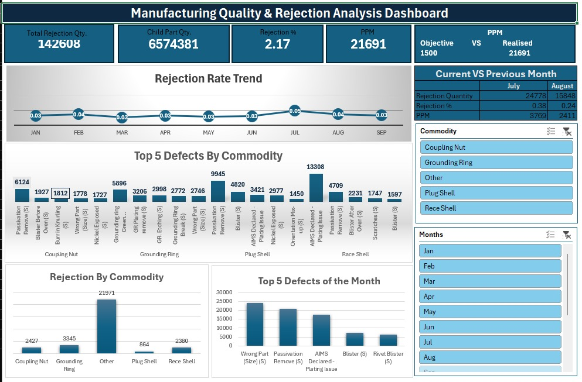

# 📊 Manufacturing Quality & Rejection Analysis Dashboard

## 📌 Project Overview

This project focuses on analyzing manufacturing production and rejection data to monitor product quality, identify major defect contributors, and evaluate rejection performance against quality targets.

The interactive dashboard transforms raw manufacturing data into meaningful visual insights, helping quality and production teams understand where rejections are occurring, which defects contribute most to quality issues, and how performance changes over time.

## 🎯 Business Problem

Manufacturing companies need to maintain product quality while minimizing production rejections.

However, analyzing large volumes of production data manually makes it difficult to:

- Identify commodities with the highest rejection quantities.
- Detect recurring defects affecting product quality.
- Monitor rejection trends across different months.
- Compare actual PPM against the defined quality objective.
- Evaluate whether rejection performance is improving or declining.

This project addresses these challenges through an interactive rejection analysis dashboard.

## 🎯 Project Objectives

- Monitor overall production and rejection quantities.
- Calculate and track rejection percentage.
- Compare actual PPM against the target PPM.
- Identify the top 5 defects for each commodity.
- Analyze commodity-wise rejection contributions.
- Track monthly rejection trends.
- Compare current and previous month performance.

## 📈 Key Performance Indicators (KPIs)

| KPI | Value |
|---|---:|
| Total Rejection Quantity | 142,608 |
| Child Part Quantity | 6,574,381 |
| Rejection Percentage | 2.17% |
| Actual PPM | 21,691 |
| Target PPM | 1,500 |

## 📊 Dashboard Features

1. **Rejection Rate Trend:** Tracks monthly changes in rejection percentage.
2. **Top 5 Defects by Commodity:** Identifies the major defects contributing to rejections within each commodity.
3. **Commodity-wise Rejection Analysis:** Compares rejection quantities across different commodities.
4. **Top 5 Defects of the Month:** Highlights the most significant defects for the selected month.
5. **Current vs Previous Month:** Compares rejection quantity, rejection percentage, and PPM.
6. **Interactive Filters:** Allows users to filter the dashboard by commodity and month.

## 💡 Business Insights

The dashboard helps identify:

- The commodities contributing most to overall rejection quantities.
- The defects that require priority investigation.
- Monthly variations in manufacturing quality.
- The gap between actual PPM and the quality objective.
- Areas where corrective and preventive actions may be required.

## 🛠️ Tools & Technologies

- Microsoft Excel
- Pivot Tables
- Pivot Charts
- Excel Slicers
- Data Analysis
- Data Visualization

## 🎯 Expected Business Value

This dashboard supports data-driven quality monitoring by helping teams prioritize defect investigations, track quality KPIs, identify rejection patterns, and make informed decisions to improve manufacturing performance.

## 📷 Dashboard Preview

## 👩‍💻 Author

Created as part of my Data Analytics learning journey, focusing on solving real-world business problems through data analysis and visualization.
